<p align="center">
  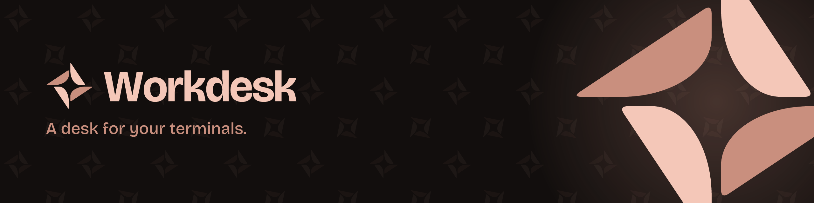
</p>

<p align="center">
  <b>A terminal app for people who keep a lot of shells open.</b><br>
  Dev servers, test watchers, logs, and a few Claude Code agents, all in one tidy desk.
</p>

<p align="center">
  <a href="https://github.com/kevingoenadibrata/workdesk/releases/latest"></a>
  
  
  
</p>

<p align="center">
  <a href="https://github.com/kevingoenadibrata/workdesk/releases/latest"><b>⬇&nbsp; Download for macOS</b></a>
  &nbsp;·&nbsp;
  <a href="#features">Features</a>
  &nbsp;·&nbsp;
  <a href="#keyboard-shortcuts">Shortcuts</a>
  &nbsp;·&nbsp;
  <a href="#build-from-source">Build from source</a>
</p>

<br>

<p align="center">
  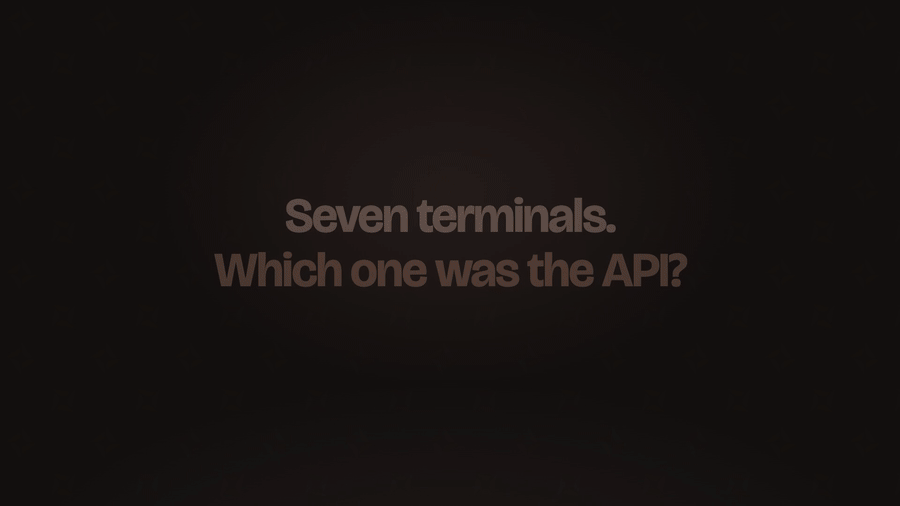
</p>

<br>

## Why Workdesk?

Seven terminals open. Which one was the API?

In most terminals every tab is called `zsh`. In Workdesk each tab is **named after its folder**, sits in a **colored group**, and is one keystroke away. Teleport opens a new tab in any folder, and `@macros` start your tools there for you, so Claude is already running when the tab opens.

<br>

## Features

<table>
<tr>
<td width="50%" valign="top">

### 🗂️ Tabs that name themselves
Vertical tabs take the name of the folder they're in, so `api`, `web` and `billing` stay apart. Put them in **colored groups**, collapse what you aren't using, and hold <kbd>⌘</kbd> to see the shortcut for every tab.

</td>
<td width="50%">
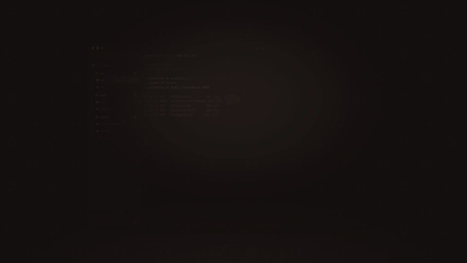
</td>
</tr>
<tr>
<td width="50%">
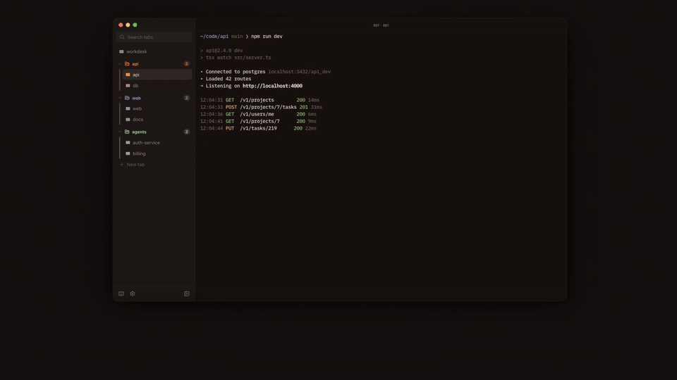
</td>
<td width="50%" valign="top">

### 🪟 Split panes
<kbd>⌘</kbd><kbd>D</kbd> splits right and <kbd>⌘</kbd><kbd>⇧</kbd><kbd>D</kbd> splits down, up to six panes per tab. Maximize one pane, move between them with the arrow keys, or unsplit them back into tabs.

</td>
</tr>
<tr>
<td width="50%" valign="top">

### 🔎 Find any tab
<kbd>⌘</kbd><kbd>F</kbd> and start typing. Results narrow as you type, and <kbd>Enter</kbd> jumps straight to that tab. You don't have to scroll through a long tab bar.

</td>
<td width="50%">
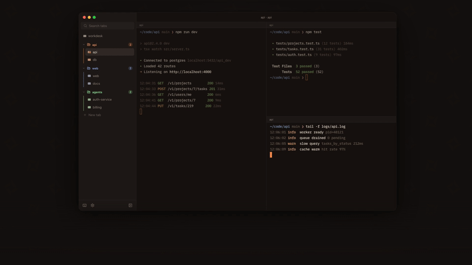
</td>
</tr>
<tr>
<td width="50%">
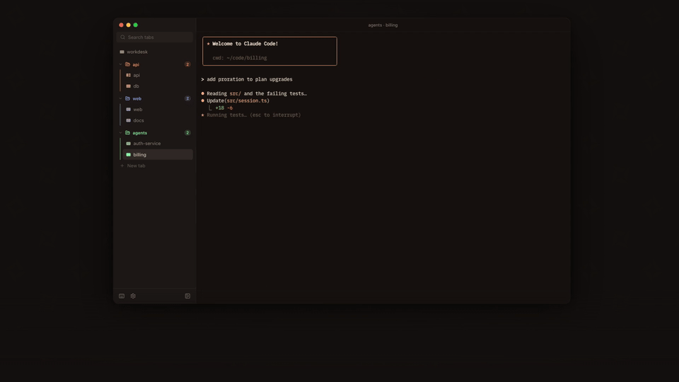
</td>
<td width="50%" valign="top">

### 🌀 Teleport + `@macros`
<kbd>⌘</kbd><kbd>⇧</kbd><kbd>T</kbd> opens a new tab in **any folder**, with fuzzy path search, favorites and recents. Type `@claude infra` and the tab opens in `infra` with Claude Code already running. You can define your own macros, and **loadouts** that open a whole set of groups, tabs and panes at once.

</td>
</tr>
<tr>
<td width="50%" valign="top">

### 🎨 149 themes, switched live
Hand-made originals like **Ember**, **Glacier** and **Sakura Night**, plus the popular schemes you already know. The whole app recolors as you click. There are also ten alternate Dock icons to pick from.

</td>
<td width="50%">
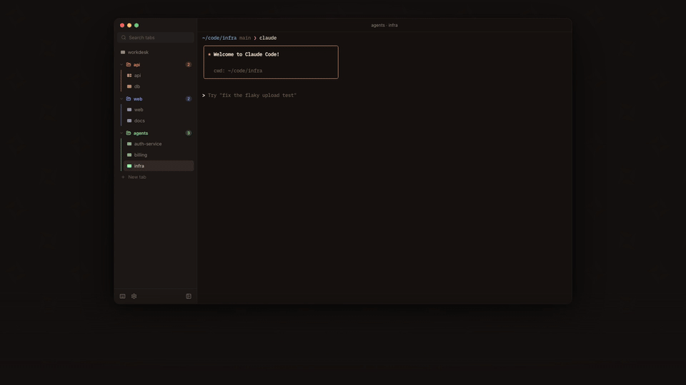
</td>
</tr>
</table>

<br>

### 🤖 Agent Monitor

<kbd>⌘</kbd><kbd>⇧</kbd><kbd>M</kbd> opens one page that shows every coding agent running in your panes: **Claude Code**, **Codex** and **opencode**. For each one you see what it's doing, the last thing you asked it, and whether it's **waiting on you**. Click a card to jump to its pane. A side panel shows your **5-hour and weekly usage limits** for each harness, so a limit doesn't catch you halfway through a task.

<p align="center">
  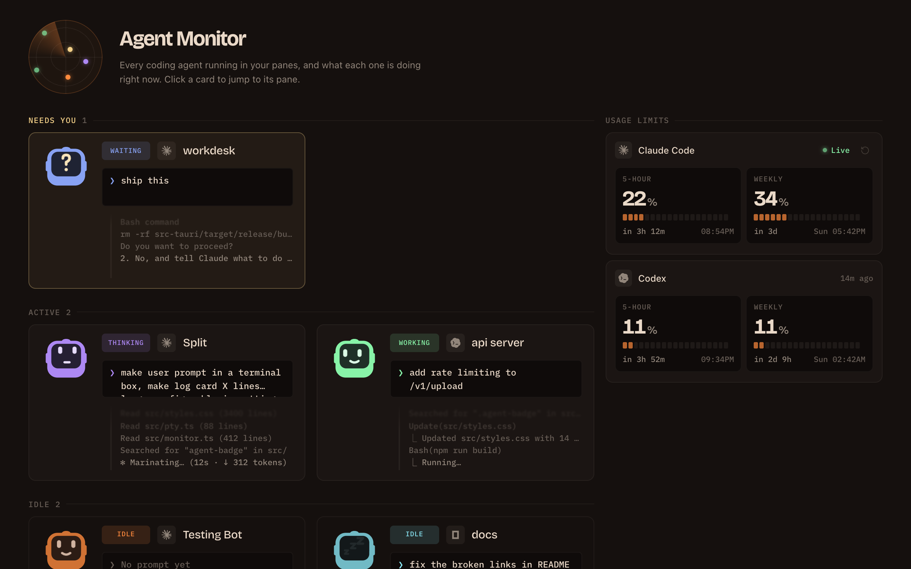
</p>

<br>

### ✨ And the small stuff

- **Sessions restore.** Quit and reopen, and your tabs, groups and splits are where you left them.
- **⌘-click a file path** in the output to open it at that line in VS Code, Cursor, Zed, Windsurf, Sublime or Xcode.
- **Drag files in.** Dropped files are pasted as shell-escaped paths, so you can drop images onto Claude Code.
- **Safe close.** Workdesk asks before closing a pane that's still running something.
- **Rebindable shortcuts**, a searchable shortcuts page, and terminal search (<kbd>⌘</kbd><kbd>⇧</kbd><kbd>F</kbd>).
- **WebGL rendering** via xterm.js, so even very long logs scroll smoothly.
- **Auto-updates.** New releases install from inside the app.

<p align="center">
  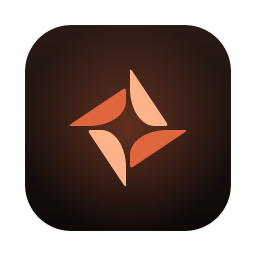
  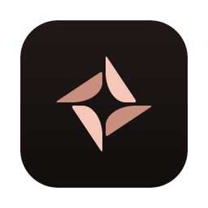
  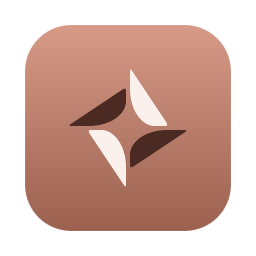
  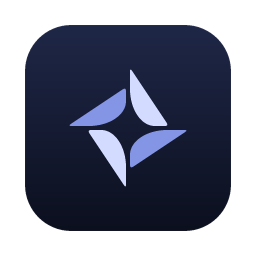
  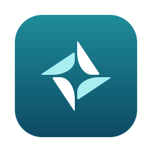
  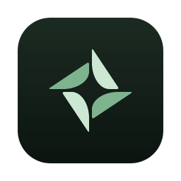
  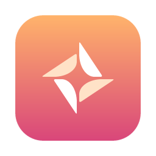
  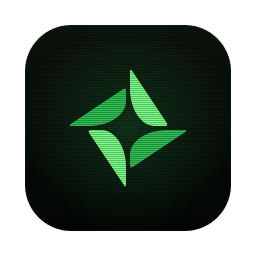
  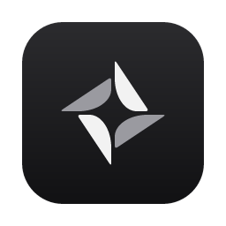
  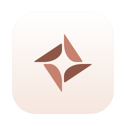
  <br>
  <sub>Pick your Dock icon in Settings → Appearance.</sub>
</p>

<br>

## Install

1. Download the latest **`Workdesk_x.y.z_aarch64.dmg`** from [Releases](https://github.com/kevingoenadibrata/workdesk/releases/latest).
2. Drag **Workdesk** into **Applications**.
3. Open it. Later updates install from inside the app.

> [!NOTE]
> Builds are for Apple Silicon Macs and aren't notarized yet. If macOS refuses to open the app, run:
> ```sh
> xattr -dr com.apple.quarantine /Applications/Workdesk.app
> ```

<br>

## Keyboard shortcuts

Hold <kbd>⌘</kbd> anywhere to see hints, or press <kbd>⌘</kbd><kbd>/</kbd> for the full list. Every shortcut can be rebound.

| | Shortcut | |
|---|---|---|
| **New tab** | <kbd>⌘</kbd><kbd>T</kbd> | Opens in the current folder |
| **Teleport** | <kbd>⌘</kbd><kbd>⇧</kbd><kbd>T</kbd> | Opens a new tab in any folder |
| **Search tabs** | <kbd>⌘</kbd><kbd>F</kbd> | |
| **Go to tab** | <kbd>⌘</kbd><kbd>1</kbd> … <kbd>⌘</kbd><kbd>9</kbd> | <kbd>9</kbd> goes to the last tab |
| **Split right / down** | <kbd>⌘</kbd><kbd>D</kbd> / <kbd>⌘</kbd><kbd>⇧</kbd><kbd>D</kbd> | Up to six panes |
| **Maximize pane** | <kbd>⌘</kbd><kbd>⇧</kbd><kbd>↩</kbd> | |
| **Next / previous pane** | <kbd>⌘</kbd><kbd>]</kbd> / <kbd>⌘</kbd><kbd>[</kbd> | |
| **Group selected tabs** | <kbd>⌘</kbd><kbd>G</kbd> | |
| **Agent Monitor** | <kbd>⌘</kbd><kbd>⇧</kbd><kbd>M</kbd> | |
| **Local Servers** | <kbd>⌘</kbd><kbd>⇧</kbd><kbd>L</kbd> | |
| **Settings** | <kbd>⌘</kbd><kbd>,</kbd> | |
| **Toggle sidebar** | <kbd>⌘</kbd><kbd>B</kbd> | |

<br>

## Build from source

You need [Node.js](https://nodejs.org) (LTS), [Rust](https://rustup.rs), and the [Tauri prerequisites](https://tauri.app/start/prerequisites/) for macOS.

```sh
git clone https://github.com/kevingoenadibrata/workdesk.git
cd workdesk
npm install
npm run tauri dev      # run with hot reload
npm run tauri build    # build a release .app / .dmg
```

**Stack:** [Tauri 2](https://tauri.app) (Rust) · TypeScript + Vite, no framework · [xterm.js](https://xtermjs.org) with WebGL · [Lucide](https://lucide.dev) icons

<br>

<p align="center">
  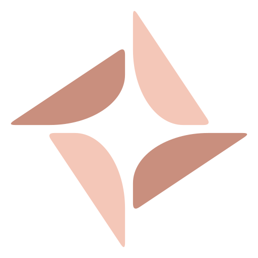<br>
  <sub><b>Workdesk</b> · A desk for your terminals.</sub>
</p>
